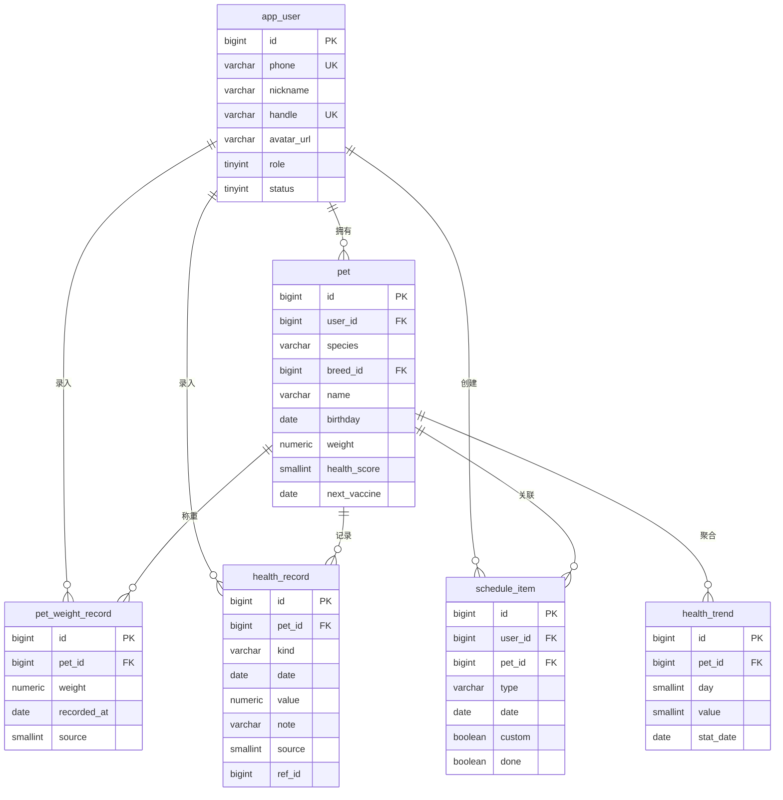
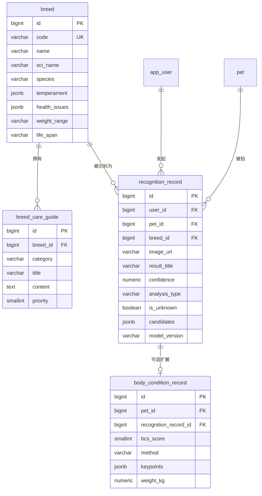
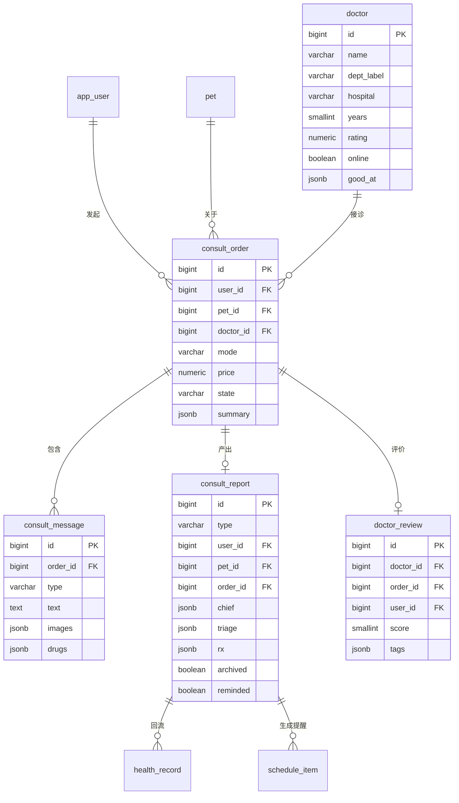
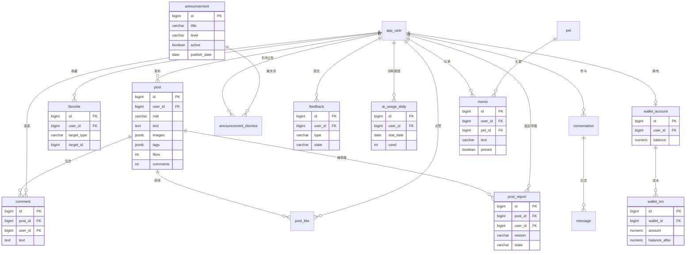

# 数据库设计文档

> 配套阅读：`API.md`（接口契约，字段以此为准）、`ARCHITECTURE.md`（服务边界）、
> `FEATURES.md`（功能行为）、`REPO-STRUCTURE.md`（目录职责）。
> 本文回答：**有哪些表、每张表存什么、为什么这样设计、从 localStorage 怎么迁过来**。

## 状态图例

| 标记 | 含义 |
| --- | --- |
| ✅ | 已在数据库建表，代码可直接读写 |
| 🟡 | 设计完成、DDL 已给出，但**尚未执行**（等 `services/api` 接库） |
| ⬜ | 依赖尚不存在的模型能力，表结构已预留 |

---

## 1. 先看清现状（很重要）

数据库里**现在只有 2 张表**，都属于智能体知识库：

```
PostgreSQL 16 (pgvector/pgvector:pg16)  ←  infra/compose/compose.yml
├── kb_document   ✅  知识文档元数据
└── kb_chunk      ✅  切分片段 + 向量
```

**其余 22 张业务表一张都不存在。** 宠物档案、日程、问诊单、报告、识别记录等全部躺在
前端 `localStorage`（11 个键，映射见 §8）。`services/api/app/models/` 与
`services/api/migrations/` 都是只有 `__init__.py` 的空目录。

这带来三个必须先处理的**事实性问题**：

1. **方言不一致**：`API.md` §3.2 的表结构写的是「类型以 MySQL 8 为例」，但线上跑的是
   PostgreSQL 16。本文档统一按 PostgreSQL 重新给出类型；`API.md` §3.2 建议同步修正为
   「以 PostgreSQL 16 为例」，否则两处会互相矛盾。
2. **`user` 是 PostgreSQL 保留字**。表名叫 `user` 必须处处写双引号，SQLAlchemy 也会踩坑。
   本文档统一改名 `app_user`（`API.md` §3.2 的 `user` 相应迁移）。
3. **没有迁移工具**。建表靠 `services/agent/app/knowledge/db.py` 的
   `Base.metadata.create_all()`，它只能建表、不能改表。加字段、改类型时只会静默失败。
   方案见 §9。

另外：agent 的 `Base`（`kb_*` 两张表）与未来 api 的 `Base`（业务表）是**两个独立的
metadata**，都往同一个 `petwise` 库 `create_all`。当前表名不重叠所以能跑，但没有任何东西
保证以后也不重叠——建议 §9 的方案 B。

---

## 2. 实体关系总览

按域拆成四张图，比一张 24 节点的大图可读。

### 2.1 身份与宠物域



### 2.2 识别与品种域（cv 的落点）

这张图回答用户最关心的问题：**cv 只输出品种，怎么变成建议**。链路见 §6。



### 2.3 问诊域



### 2.4 社区与运营域



---

## 3. 已建表：知识库域（✅）

这两张表是唯一真正在跑的表，定义见
`services/agent/app/knowledge/models.py`，索引见同目录 `schema.sql`。

### 3.1 `kb_document`

一篇知识文档的元数据。`source_type` 决定它参与哪类问题的检索。

| 字段 | 类型 | 说明 |
| --- | --- | --- |
| `id` | varchar(64) PK | 文档 ID（如 `d_breed_corgi`） |
| `source_type` | varchar(32) | `breed` / `disease` / `care` / `faq` / `first_aid` |
| `title` | varchar(200) | 标题，同时是回答引用的书名 |
| `species` | varchar(16) | `dog` / `cat` / `all` |
| `tags` | jsonb | 标签数组，默认 `[]` |
| `source_uri` | varchar(500) | 来源出处，用于溯源 |
| `version` | varchar(32) | 版本，默认 `v1` |
| `updated_at` | timestamptz | 更新时间 |

> 注意：这张表**没有 `created_at`**，只有 `updated_at`。新建与更新在模型层无法区分，
> 需要数据新鲜度统计时会受影响。加一列即可，但要用迁移改（见 §9）。

### 3.2 `kb_chunk`

检索的最小单元。切分参数在 `config.py`：`CHUNK_SIZE=380`、`CHUNK_OVERLAP=60`。

| 字段 | 类型 | 说明 |
| --- | --- | --- |
| `id` | varchar(96) PK | 片段 ID |
| `document_id` | varchar(64) FK → `kb_document.id` ON DELETE CASCADE | |
| `chunk_index` | integer | 段内序号，与 `document_id` 联合唯一 |
| `heading` | varchar(200) | 所属小标题，用于生成引用 `《犬瘟热》· 症状识别` |
| `content` | text | 正文 |
| `token_count` | integer | token 数，用于上下文预算 |
| `meta` | jsonb | 附加元信息 |
| `embedding` | vector(768) | 向量，维度由 `EMBEDDING_DIM` 决定 |

**换 embedding 模型必须重建这张表**——维度变了旧向量全部作废。当前
`EMBEDDING_PROVIDER=hash`（零依赖兜底），注释里明确写了"禁止用于论文评测"，
上线前必须切到 `bge-small-zh-v1.5`（`EMBEDDING_DIM=768` 刚好匹配）。

### 3.3 索引

```sql
-- 向量通道：HNSW，召回速度与构建成本的平衡点
CREATE INDEX IF NOT EXISTS ix_kb_chunk_embedding_hnsw
    ON kb_chunk USING hnsw (embedding vector_cosine_ops)
    WITH (m = 16, ef_construction = 64);

-- 关键词通道：pg_trgm 服务 ILIKE 模糊匹配（中文不走 tsvector 分词）
CREATE EXTENSION IF NOT EXISTS pg_trgm;
CREATE INDEX IF NOT EXISTS ix_kb_chunk_content_trgm
    ON kb_chunk USING gin (content gin_trgm_ops);

-- 元信息过滤：物种 + 来源类型是最高频的查询形态
CREATE INDEX IF NOT EXISTS ix_kb_document_filter
    ON kb_document (source_type, species);
```

检索是混合式的：`VECTOR_WEIGHT=0.7` + `KEYWORD_WEIGHT=0.3`，
粗召回 `RETRIEVAL_CANDIDATES=30` 条，重排后取 `RETRIEVAL_TOP_K=6` 条，
低于 `SIMILARITY_THRESHOLD=0.30` 视为无关。同一文档最多返回
`MAX_CHUNKS_PER_DOC=2` 段，避免上下文被单篇文章占满。

---

## 4. 业务表设计（🟡）

以下为 PostgreSQL 16 可直接执行的 DDL。约定：

- 主键一律 `bigint generated always as identity`（不自增跳跃、可 `OVERRIDING` 批量导入）
- 时间一律 `timestamptz`，业务日期用 `date`
- JSON 一律 `jsonb`（可建 GIN 索引、可去重，比 `json` 更实用）
- 金额用 `numeric`，不用浮点
- 需要审计的表带 `created_at` / `updated_at`，`updated_at` 由触发器维护
- 列表页查询一律"最新在前"，所以索引多为 `(fk, created_at desc)` 形态

### 4.1 公共约定

```sql
CREATE EXTENSION IF NOT EXISTS pgcrypto;   -- gen_random_uuid()

-- updated_at 自动维护
CREATE OR REPLACE FUNCTION set_updated_at() RETURNS trigger AS $$
BEGIN
    NEW.updated_at := now();
    RETURN NEW;
END;
$$ LANGUAGE plpgsql;

-- 用法（每张表各建一个，触发器名唯一）：
-- CREATE TRIGGER trg_pet_updated BEFORE UPDATE ON pet
--     FOR EACH ROW EXECUTE FUNCTION set_updated_at();
```

### 4.2 身份域

```sql
CREATE TABLE app_user (
    id            bigint GENERATED ALWAYS AS IDENTITY PRIMARY KEY,
    phone         varchar(20)  NOT NULL UNIQUE,
    password_hash varchar(128),                       -- 仅密码登录时使用
    nickname      varchar(32)  NOT NULL DEFAULT '',
    handle        varchar(32)  NOT NULL UNIQUE,       -- @manman
    avatar_url    varchar(255) NOT NULL DEFAULT '',
    bio           varchar(120) NOT NULL DEFAULT '',
    followers     int NOT NULL DEFAULT 0,             -- 冗余计数，避免每次 count
    following     int NOT NULL DEFAULT 0,
    role          smallint NOT NULL DEFAULT 0,        -- 0 用户 / 1 医生 / 2 管理员
    status        smallint NOT NULL DEFAULT 1,        -- 1 正常 / 0 禁用
    created_at    timestamptz NOT NULL DEFAULT now(),
    updated_at    timestamptz NOT NULL DEFAULT now()
);
CREATE INDEX ix_app_user_role_status ON app_user (role, status);

CREATE TABLE user_session (                       -- 刷新令牌，支持登出与踢下线
    id            bigint GENERATED ALWAYS AS IDENTITY PRIMARY KEY,
    user_id       bigint NOT NULL REFERENCES app_user(id) ON DELETE CASCADE,
    refresh_token varchar(128) NOT NULL UNIQUE,
    user_agent    varchar(255) NOT NULL DEFAULT '',
    expires_at    timestamptz NOT NULL,
    created_at    timestamptz NOT NULL DEFAULT now()
);
CREATE INDEX ix_user_session_user ON user_session (user_id, expires_at desc);
```

> `user_session` 是 `API.md` §3.2 没有的表。前端登录态现在是
> `localStorage.petwise_auth`（演示），接后端后应改为 HttpOnly Cookie + 刷新令牌，
> 否则 XSS 可直接读令牌。

### 4.3 宠物域

```sql
CREATE TABLE pet (
    id            bigint GENERATED ALWAYS AS IDENTITY PRIMARY KEY,
    user_id       bigint NOT NULL REFERENCES app_user(id) ON DELETE CASCADE,
    name          varchar(32)  NOT NULL,
    species       varchar(16)  NOT NULL,             -- cat / dog / other
    breed_id      bigint,                            -- → breed.id，可空
    breed         varchar(64)  NOT NULL DEFAULT '',  -- 品种文本冗余，breed_id 为空时展示
    gender        varchar(4)   NOT NULL DEFAULT '',
    birthday      date,
    weight        numeric(5,2),
    tagline       varchar(64)  NOT NULL DEFAULT '',
    health_score  smallint     NOT NULL DEFAULT 0,   -- 0-100
    next_vaccine  date,
    avatar_url    varchar(255) NOT NULL DEFAULT '',
    deleted_at    timestamptz,                       -- 软删除：宠物档案有长期价值
    created_at    timestamptz NOT NULL DEFAULT now(),
    updated_at    timestamptz NOT NULL DEFAULT now()
);
CREATE INDEX ix_pet_user ON pet (user_id) WHERE deleted_at IS NULL;
CREATE INDEX ix_pet_breed ON pet (breed_id) WHERE deleted_at IS NULL;

CREATE TABLE pet_weight_record (
    id          bigint GENERATED ALWAYS AS IDENTITY PRIMARY KEY,
    pet_id      bigint NOT NULL REFERENCES pet(id) ON DELETE CASCADE,
    weight      numeric(5,2) NOT NULL CHECK (weight > 0 AND weight < 200),
    recorded_at date NOT NULL,
    source      smallint NOT NULL DEFAULT 1,         -- 1 手动 / 2 问诊回流
    created_at  timestamptz NOT NULL DEFAULT now()
);
CREATE UNIQUE INDEX uq_pet_weight_day ON pet_weight_record (pet_id, recorded_at);

CREATE TABLE health_record (
    id         bigint GENERATED ALWAYS AS IDENTITY PRIMARY KEY,
    pet_id     bigint NOT NULL REFERENCES pet(id) ON DELETE CASCADE,
    user_id    bigint NOT NULL REFERENCES app_user(id) ON DELETE CASCADE,
    kind       varchar(16) NOT NULL,                 -- weight / diet / symptom / care
    date       date NOT NULL,
    value      numeric(6,2),                         -- 数值型记录（如体重）
    note       varchar(500) NOT NULL DEFAULT '',
    source     smallint NOT NULL DEFAULT 1,          -- 1 用户录入 / 2 问诊报告回流
    ref_id     bigint,                               -- source=2 时指向 consult_report.id
    deleted_at timestamptz,
    created_at timestamptz NOT NULL DEFAULT now()
);
CREATE INDEX ix_health_record_pet ON health_record (pet_id, date desc);
CREATE INDEX ix_health_record_user ON health_record (user_id, date desc);

CREATE TABLE health_trend (                    -- 首页周健康环形图的数据源
    id        bigint GENERATED ALWAYS AS IDENTITY PRIMARY KEY,
    pet_id    bigint NOT NULL REFERENCES pet(id) ON DELETE CASCADE,
    day       smallint NOT NULL CHECK (day BETWEEN 1 AND 7),
    value     smallint NOT NULL CHECK (value BETWEEN 0 AND 100),
    stat_date date NOT NULL,
    created_at timestamptz NOT NULL DEFAULT now()
);
CREATE UNIQUE INDEX uq_health_trend_day ON health_trend (pet_id, stat_date, day);

CREATE TABLE schedule_item (
    id         bigint GENERATED ALWAYS AS IDENTITY PRIMARY KEY,
    user_id    bigint NOT NULL REFERENCES app_user(id) ON DELETE CASCADE,
    pet_id     bigint,                              -- 空 = 通用日程
    title      varchar(64) NOT NULL,
    type       varchar(16) NOT NULL DEFAULT 'other',-- vaccine / deworm / check / weight / groom / other
    date       date NOT NULL,
    cycle      varchar(32) NOT NULL DEFAULT '',     -- "每季度一次"
    custom     boolean NOT NULL DEFAULT false,      -- 1 用户自建 / 0 系统周期生成
    done       boolean NOT NULL DEFAULT false,
    done_at    timestamptz,
    deleted_at timestamptz,
    created_at timestamptz NOT NULL DEFAULT now(),
    updated_at timestamptz NOT NULL DEFAULT now()
);
CREATE INDEX ix_schedule_user_date ON schedule_item (user_id, date);
CREATE INDEX ix_schedule_pet_date ON schedule_item (pet_id, date) WHERE pet_id IS NOT NULL;

CREATE TABLE memo (                            -- 日程页备忘录：无日期的随手记，置顶优先
    id         bigint GENERATED ALWAYS AS IDENTITY PRIMARY KEY,
    user_id    bigint NOT NULL REFERENCES app_user(id) ON DELETE CASCADE,
    pet_id     bigint REFERENCES pet(id) ON DELETE CASCADE,  -- 空 = 不限宠物
    text       varchar(200) NOT NULL,
    pinned     boolean NOT NULL DEFAULT false,
    deleted_at timestamptz,
    created_at timestamptz NOT NULL DEFAULT now()
);
CREATE INDEX ix_memo_user ON memo (user_id, pinned desc, created_at desc) WHERE deleted_at IS NULL;
```

> `schedule_item.done` 直接放在行上，而不是 `API.md` §3.2 提的独立
> `schedule_done` 表。理由：日程总量小（单用户几十条）、完成状态只有一份来源，
> 拆表会让"列表 + 完成状态"变成两次查询。**代价**：如果将来要做"谁完成了哪个周期任务"
> 的历史统计（同一 item 反复完成），就必须改成独立表。

### 4.4 识别与品种域

这是 cv 模型的直接落点，字段与 `services/vision/app/schemas.py` 的
`RecognitionResult` 一一对应，不重不漏。

```sql
CREATE TABLE breed (
    id            bigint GENERATED ALWAYS AS IDENTITY PRIMARY KEY,
    code          varchar(32) NOT NULL UNIQUE,       -- cv labels.json 的 breedId，如 dog-n02116738
    name          varchar(64) NOT NULL,              -- 中文名
    sci_name      varchar(128) NOT NULL DEFAULT '',  -- 拉丁学名
    species       varchar(16) NOT NULL,              -- dog / cat
    origin        varchar(64)  NOT NULL DEFAULT '',
    temperament   jsonb NOT NULL DEFAULT '[]',       -- ["活泼","亲人"]
    weight_range  varchar(32)  NOT NULL DEFAULT '',  -- "10-12kg"
    life_span     varchar(32)  NOT NULL DEFAULT '',  -- "12-15 年"
    health_issues jsonb NOT NULL DEFAULT '[]',       -- 易患疾病
    care_guide    text NOT NULL DEFAULT '',          -- 护理要点摘要
    cover_url     varchar(255) NOT NULL DEFAULT '',
    created_at    timestamptz NOT NULL DEFAULT now(),
    updated_at    timestamptz NOT NULL DEFAULT now()
);
CREATE UNIQUE INDEX uq_breed_species_code ON breed (species, code);
CREATE INDEX ix_breed_species ON breed (species);

-- 品种建议条目：一张品种对应多条，按 category 分组、priority 排序
CREATE TABLE breed_care_guide (
    id         bigint GENERATED ALWAYS AS IDENTITY PRIMARY KEY,
    breed_id   bigint NOT NULL REFERENCES breed(id) ON DELETE CASCADE,
    category   varchar(16) NOT NULL,   -- diet / exercise / grooming / health / training
    title      varchar(64) NOT NULL,
    content    text NOT NULL,
    priority   smallint NOT NULL DEFAULT 0,          -- 越大越靠前
    created_at timestamptz NOT NULL DEFAULT now()
);
CREATE INDEX ix_bcg_breed ON breed_care_guide (breed_id, priority desc);

CREATE TABLE recognition_record (
    id             bigint GENERATED ALWAYS AS IDENTITY PRIMARY KEY,
    user_id        bigint NOT NULL REFERENCES app_user(id) ON DELETE CASCADE,
    pet_id         bigint REFERENCES pet(id) ON DELETE SET NULL,
    breed_id       bigint REFERENCES breed(id) ON DELETE SET NULL,
    image_url      varchar(255) NOT NULL DEFAULT '',  -- MinIO 对象 key，非公网 URL
    result_title   varchar(64)  NOT NULL DEFAULT '',
    sci_name       varchar(128) NOT NULL DEFAULT '',
    species        varchar(16)  NOT NULL DEFAULT '',
    confidence     numeric(4,3) NOT NULL CHECK (confidence >= 0 AND confidence <= 1),
    is_unknown     boolean NOT NULL DEFAULT false,     -- 拒识标记
    analysis_type  varchar(16) NOT NULL DEFAULT 'breed',  -- breed / body_condition / mixed
    candidates     jsonb NOT NULL DEFAULT '[]',        -- top-k 候选 [{breedId,title,confidence}]
    metrics        jsonb NOT NULL DEFAULT '[]',        -- [{label,value,state}]
    note           varchar(500) NOT NULL DEFAULT '',
    model_version  varchar(32) NOT NULL DEFAULT '',    -- 如 model-dog-v1
    kind           varchar(16) NOT NULL DEFAULT '',    -- vision 路由用的 dog / cat
    corrected_breed_id bigint REFERENCES breed(id) ON DELETE SET NULL,  -- 用户手动纠正后的品种
    review_status  varchar(16) NOT NULL DEFAULT 'done', -- done / review / approved / rejected
    reviewed_by    bigint REFERENCES app_user(id),      -- 审核人（管理端）
    reviewed_at    timestamptz,
    latency_ms     integer,
    created_at     timestamptz NOT NULL DEFAULT now()
);
CREATE INDEX ix_recog_user ON recognition_record (user_id, created_at desc);
CREATE INDEX ix_recog_pet ON recognition_record (pet_id, created_at desc);
CREATE INDEX ix_recog_breed ON recognition_record (breed_id);
CREATE INDEX ix_recog_unknown ON recognition_record (is_unknown, created_at desc);
CREATE INDEX ix_recog_review ON recognition_record (review_status, created_at desc);
```

四个字段是刻意加的，`API.md` §3.2 里没有：

- `candidates` —— vision 已经返回 top-k，存下来才能做"结果纠错"（用户说认错了，
  从候选里选一个改），也是模型效果回归分析的原料。
- `model_version` —— 换模型重训后，老记录得能区分是哪版模型判的。
- `kind` —— 记录走了哪条路由（dog/cat/auto），排查"为什么把猫认成狗"必需。
- `analysis_type` —— **为体态分析预留的唯一扩展点**，见 §6.3。

后三个字段（`corrected_breed_id` / `review_status` / `reviewed_by`）支撑**数据回流闭环**：
用户在识别页手动纠正 → `review_status='review'` 进管理端审核队列 → 通过置 `approved`
（该样本即可导出为训练集，见 API.md §4.18.6）→ 驳回置 `rejected`（`corrected_breed_id` 清空，
展示回模型原预测）。审核通过的正确标注是增量训练最珍贵的种子数据。

### 4.5 体态分析（⬜）

```sql
CREATE TABLE body_condition_record (
    id                    bigint GENERATED ALWAYS AS IDENTITY PRIMARY KEY,
    pet_id                bigint NOT NULL REFERENCES pet(id) ON DELETE CASCADE,
    user_id               bigint NOT NULL REFERENCES app_user(id) ON DELETE CASCADE,
    recognition_record_id bigint REFERENCES recognition_record(id) ON DELETE SET NULL,
    image_url             varchar(255) NOT NULL DEFAULT '',
    bcs_score             smallint NOT NULL CHECK (bcs_score BETWEEN 1 AND 9),
    bcs_label             varchar(16) NOT NULL,        -- 过瘦 / 理想 / 超重 / 肥胖
    method                varchar(16) NOT NULL,        -- model / manual
    keypoints              jsonb NOT NULL DEFAULT '[]', -- 关键点 [{name,x,y,score}]
    weight_kg             numeric(5,2),
    note                  varchar(500) NOT NULL DEFAULT '',
    measured_at           timestamptz NOT NULL DEFAULT now(),
    created_at            timestamptz NOT NULL DEFAULT now()
);
CREATE INDEX ix_bcs_pet ON body_condition_record (pet_id, measured_at desc);
```

**这张表现在不要执行**，它依赖尚不存在的能力，详见 §6.3。

### 4.6 问诊域

```sql
CREATE TABLE doctor (
    id           bigint GENERATED ALWAYS AS IDENTITY PRIMARY KEY,
    user_id      bigint REFERENCES app_user(id) ON DELETE SET NULL,  -- 关联登录账号
    name         varchar(32)  NOT NULL,
    title        varchar(32)  NOT NULL DEFAULT '',   -- 职称：主治医师
    dept         varchar(32)  NOT NULL DEFAULT '',
    dept_label   varchar(32)  NOT NULL DEFAULT '',   -- 科室中文名
    hospital     varchar(128) NOT NULL DEFAULT '',
    years        smallint NOT NULL DEFAULT 0,
    rating       numeric(2,1) NOT NULL DEFAULT 5.0,
    consults     int NOT NULL DEFAULT 0,
    online       boolean NOT NULL DEFAULT false,     -- 由 Redis 心跳维护，不落库推导
    response_min int NOT NULL DEFAULT 0,
    tags         jsonb NOT NULL DEFAULT '[]',
    good_at      jsonb NOT NULL DEFAULT '[]',
    intro        varchar(500) NOT NULL DEFAULT '',
    certs        jsonb NOT NULL DEFAULT '[]',
    slot         varchar(64)  NOT NULL DEFAULT '',   -- 排班展示文本
    avatar_url   varchar(255) NOT NULL DEFAULT '',
    status       smallint NOT NULL DEFAULT 1,
    created_at   timestamptz NOT NULL DEFAULT now(),
    updated_at   timestamptz NOT NULL DEFAULT now()
);
CREATE INDEX ix_doctor_dept ON doctor (dept, status, rating desc);

CREATE TABLE consult_order (
    id         bigint GENERATED ALWAYS AS IDENTITY PRIMARY KEY,
    user_id    bigint NOT NULL REFERENCES app_user(id) ON DELETE CASCADE,
    pet_id     bigint NOT NULL REFERENCES pet(id) ON DELETE RESTRICT,
    doctor_id  bigint REFERENCES doctor(id) ON DELETE SET NULL,
    mode       varchar(16) NOT NULL DEFAULT 'text',  -- text / voice / video
    price      numeric(8,2) NOT NULL DEFAULT 0,
    state      varchar(16) NOT NULL DEFAULT 'pending', -- pending / replied / closed
    summary    jsonb NOT NULL DEFAULT '{}',          -- AI 病例摘要
    created_at timestamptz NOT NULL DEFAULT now(),
    closed_at  timestamptz,
    updated_at timestamptz NOT NULL DEFAULT now()
);
CREATE INDEX ix_order_user ON consult_order (user_id, created_at desc);
CREATE INDEX ix_order_doctor ON consult_order (doctor_id, state, created_at desc);
CREATE INDEX ix_order_open ON consult_order (state) WHERE state <> 'closed';

CREATE TABLE consult_message (
    id         bigint GENERATED ALWAYS AS IDENTITY PRIMARY KEY,
    order_id   bigint NOT NULL REFERENCES consult_order(id) ON DELETE CASCADE,
    type       varchar(16) NOT NULL,                 -- user / doctor / system / rx
    text       text NOT NULL DEFAULT '',
    images     jsonb NOT NULL DEFAULT '[]',
    drugs      jsonb NOT NULL DEFAULT '[]',          -- type=rx 时的处方
    created_at timestamptz NOT NULL DEFAULT now()
);
CREATE INDEX ix_msg_order ON consult_message (order_id, created_at);

CREATE TABLE consult_report (
    id            bigint GENERATED ALWAYS AS IDENTITY PRIMARY KEY,
    type          varchar(16) NOT NULL,              -- ai / human
    user_id       bigint NOT NULL REFERENCES app_user(id) ON DELETE CASCADE,
    pet_id        bigint NOT NULL REFERENCES pet(id) ON DELETE CASCADE,
    order_id      bigint REFERENCES consult_order(id) ON DELETE SET NULL,
    title         varchar(128) NOT NULL DEFAULT '',
    preview       varchar(255) NOT NULL DEFAULT '',
    chief         jsonb NOT NULL DEFAULT '{}',       -- 结构化主诉
    triage        jsonb NOT NULL DEFAULT '{}',       -- level/score/factors/causes/actions
    doctor        jsonb NOT NULL DEFAULT '{}',
    doctor_advice text NOT NULL DEFAULT '',
    rx            jsonb NOT NULL DEFAULT '{}',       -- {drugs:[], note}
    archived      boolean NOT NULL DEFAULT false,    -- 是否已回流健康档案
    reminded      boolean NOT NULL DEFAULT false,    -- 是否已生成日程提醒
    date          date NOT NULL,
    deleted_at    timestamptz,
    created_at    timestamptz NOT NULL DEFAULT now(),
    updated_at    timestamptz NOT NULL DEFAULT now()
);
CREATE INDEX ix_report_user ON consult_report (user_id, date desc);
CREATE INDEX ix_report_pet ON consult_report (pet_id, date desc);
CREATE INDEX ix_report_unarchived ON consult_report (user_id) WHERE NOT archived;

CREATE TABLE doctor_review (
    id         bigint GENERATED ALWAYS AS IDENTITY PRIMARY KEY,
    doctor_id  bigint NOT NULL REFERENCES doctor(id) ON DELETE CASCADE,
    order_id   bigint NOT NULL UNIQUE REFERENCES consult_order(id) ON DELETE CASCADE,
    user_id    bigint NOT NULL REFERENCES app_user(id) ON DELETE CASCADE,
    score      smallint NOT NULL CHECK (score BETWEEN 1 AND 5),
    tags       jsonb NOT NULL DEFAULT '[]',
    created_at timestamptz NOT NULL DEFAULT now()
);
CREATE INDEX ix_review_doctor ON doctor_review (doctor_id, created_at desc);
```

> `order_id` 上加 `UNIQUE` 是一单只能评一次。评价后 `doctor.rating` / `consults`
> 是冗余计数，需要触发器或应用层事务内更新，别信前端传来的值。

### 4.7 社区与运营域

```sql
CREATE TABLE post (
    id         bigint GENERATED ALWAYS AS IDENTITY PRIMARY KEY,
    user_id    bigint NOT NULL REFERENCES app_user(id) ON DELETE CASCADE,
    author     varchar(32) NOT NULL DEFAULT '',      -- 冗余作者昵称，避免列表页 join
    role       varchar(16) NOT NULL DEFAULT 'user',  -- user / vet
    text       text NOT NULL,
    images     jsonb NOT NULL DEFAULT '[]',
    tags       jsonb NOT NULL DEFAULT '[]',
    likes      int NOT NULL DEFAULT 0,
    comments   int NOT NULL DEFAULT 0,
    state      smallint NOT NULL DEFAULT 1,          -- 1 正常 / 0 审核下架
    deleted_at timestamptz,
    created_at timestamptz NOT NULL DEFAULT now()
);
CREATE INDEX ix_post_feed ON post (state, created_at desc) WHERE deleted_at IS NULL;
CREATE INDEX ix_post_user ON post (user_id, created_at desc);

CREATE TABLE post_like (
    id         bigint GENERATED ALWAYS AS IDENTITY PRIMARY KEY,
    post_id    bigint NOT NULL REFERENCES post(id) ON DELETE CASCADE,
    user_id    bigint NOT NULL REFERENCES app_user(id) ON DELETE CASCADE,
    created_at timestamptz NOT NULL DEFAULT now(),
    UNIQUE (post_id, user_id)
);

CREATE TABLE comment (
    id         bigint GENERATED ALWAYS AS IDENTITY PRIMARY KEY,
    post_id    bigint NOT NULL REFERENCES post(id) ON DELETE CASCADE,
    user_id    bigint NOT NULL REFERENCES app_user(id) ON DELETE CASCADE,
    text       varchar(500) NOT NULL,
    deleted_at timestamptz,
    created_at timestamptz NOT NULL DEFAULT now()
);
CREATE INDEX ix_comment_post ON comment (post_id, created_at);

CREATE TABLE conversation (
    id            bigint GENERATED AS IDENTITY PRIMARY KEY,
    user_id       bigint NOT NULL REFERENCES app_user(id) ON DELETE CASCADE,
    peer_id       bigint NOT NULL,                    -- 对方用户 ID
    last_message  varchar(255) NOT NULL DEFAULT '',
    unread        int NOT NULL DEFAULT 0,
    updated_at    timestamptz NOT NULL DEFAULT now(),
    UNIQUE (user_id, peer_id)
);

CREATE TABLE message (
    id             bigint GENERATED AS IDENTITY PRIMARY KEY,
    conversation_id bigint NOT NULL REFERENCES conversation(id) ON DELETE CASCADE,
    sender_id      bigint NOT NULL,
    text           varchar(1000) NOT NULL DEFAULT '',
    image_url      varchar(255) NOT NULL DEFAULT '',
    read           boolean NOT NULL DEFAULT false,
    created_at     timestamptz NOT NULL DEFAULT now()
);
CREATE INDEX ix_message_conv ON message (conversation_id, created_at desc);

CREATE TABLE favorite (
    id          bigint GENERATED ALWAYS AS IDENTITY PRIMARY KEY,
    user_id     bigint NOT NULL REFERENCES app_user(id) ON DELETE CASCADE,
    target_type varchar(16) NOT NULL,                 -- breed / post / tip
    target_id   bigint NOT NULL,
    created_at  timestamptz NOT NULL DEFAULT now(),
    UNIQUE (user_id, target_type, target_id)
);
CREATE INDEX ix_favorite_user ON favorite (user_id, created_at desc);

CREATE TABLE announcement (
    id           bigint GENERATED ALWAYS AS IDENTITY PRIMARY KEY,
    title        varchar(64) NOT NULL,
    body         varchar(1000) NOT NULL,
    level        varchar(16) NOT NULL DEFAULT 'info', -- event / warn / info
    active       boolean NOT NULL DEFAULT true,
    publish_date date NOT NULL,
    created_at   timestamptz NOT NULL DEFAULT now(),
    updated_at   timestamptz NOT NULL DEFAULT now()
);
CREATE INDEX ix_ann_active ON announcement (active, publish_date desc);

CREATE TABLE announcement_dismiss (
    id             bigint GENERATED ALWAYS AS IDENTITY PRIMARY KEY,
    user_id        bigint NOT NULL REFERENCES app_user(id) ON DELETE CASCADE,
    announcement_id bigint NOT NULL REFERENCES announcement(id) ON DELETE CASCADE,
    created_at     timestamptz NOT NULL DEFAULT now(),
    UNIQUE (user_id, announcement_id)
);

CREATE TABLE feedback (
    id         bigint GENERATED ALWAYS AS IDENTITY PRIMARY KEY,
    user_id    bigint NOT NULL REFERENCES app_user(id) ON DELETE CASCADE,
    type       varchar(16) NOT NULL,
    text       varchar(1000) NOT NULL,
    state      varchar(16) NOT NULL DEFAULT 'open',  -- open / processing / resolved
    reply      varchar(1000) NOT NULL DEFAULT '',    -- 管理端回复，API.md §3.2 缺此列
    created_at timestamptz NOT NULL DEFAULT now(),
    updated_at timestamptz NOT NULL DEFAULT now()
);
CREATE INDEX ix_feedback_state ON feedback (state, created_at desc);

CREATE TABLE ai_usage_daily (
    id         bigint GENERATED ALWAYS AS IDENTITY PRIMARY KEY,
    user_id    bigint NOT NULL REFERENCES app_user(id) ON DELETE CASCADE,
    stat_date  date NOT NULL,
    used       int NOT NULL DEFAULT 0,
    UNIQUE (user_id, stat_date)
);

CREATE TABLE post_report (                     -- 帖子举报：App「更多 → 举报」写入，管理端举报处理队列
    id          bigint GENERATED ALWAYS AS IDENTITY PRIMARY KEY,
    post_id     bigint NOT NULL REFERENCES post(id) ON DELETE CASCADE,
    author      varchar(32) NOT NULL DEFAULT '',  -- 冗余被举报作者昵称
    user_id     bigint REFERENCES app_user(id) ON DELETE SET NULL,  -- 举报人，可空（匿名）
    reporter    varchar(32) NOT NULL DEFAULT 'anonymous',           -- 举报人展示名（脱敏手机号）
    reason      varchar(16) NOT NULL,           -- 广告或垃圾信息 / 辱骂攻击 / 血腥暴力 / 违法违规 / 侵犯权益 / 其他
    detail      varchar(200) NOT NULL DEFAULT '',
    state       varchar(16) NOT NULL DEFAULT 'pending',  -- pending / removed / ignored
    handled_at  timestamptz,
    created_at  timestamptz NOT NULL DEFAULT now(),
    UNIQUE (post_id, user_id)                   -- 同一用户对同一帖子只能举报一次
);
CREATE INDEX ix_post_report_state ON post_report (state, created_at desc);

CREATE TABLE wallet_account (                   -- 用户钱包：一人一户
    id         bigint GENERATED ALWAYS AS IDENTITY PRIMARY KEY,
    user_id    bigint NOT NULL REFERENCES app_user(id) ON DELETE CASCADE,
    balance    numeric(10,2) NOT NULL DEFAULT 0 CHECK (balance >= 0),
    updated_at timestamptz NOT NULL DEFAULT now(),
    UNIQUE (user_id)
);

CREATE TABLE wallet_txn (                      -- 钱包流水：只追加不改
    id            bigint GENERATED ALWAYS AS IDENTITY PRIMARY KEY,
    wallet_id     bigint NOT NULL REFERENCES wallet_account(id) ON DELETE CASCADE,
    amount        numeric(10,2) NOT NULL,       -- >0 入账（充值/退款）/ <0 出账（提现/问诊支付）
    note          varchar(64) NOT NULL DEFAULT '',
    balance_after numeric(10,2) NOT NULL,       -- 交易后余额快照，对账用
    created_at    timestamptz NOT NULL DEFAULT now()
);
CREATE INDEX ix_wallet_txn_wallet ON wallet_txn (wallet_id, created_at desc);

CREATE TABLE sms_code (                        -- 验证码：频控与防爆破的落地表
    id         bigint GENERATED ALWAYS AS IDENTITY PRIMARY KEY,
    phone      varchar(11) NOT NULL,
    scene      varchar(16) NOT NULL DEFAULT 'login',  -- login / register / reset
    code_hash  varchar(64) NOT NULL,           -- 验证码哈希，禁止明文存储
    tries      smallint NOT NULL DEFAULT 0,    -- 已错误次数，5 次作废
    ip         varchar(45) NOT NULL DEFAULT '',
    consumed   boolean NOT NULL DEFAULT false,
    expires_at timestamptz NOT NULL,           -- now() + 5min
    created_at timestamptz NOT NULL DEFAULT now()
);
CREATE INDEX ix_sms_phone_recent ON sms_code (phone, created_at desc);
```

> **频控策略**（与 `API.md` §4.1.1 对齐）：发送间隔 60s、单号每日 5 条、单 IP 每小时 20 条，
> 均在本表按 `phone` / `ip` 时间窗聚合判定；`tries>=5` 或 `expires_at` 过期即拒绝校验。

---

## 5. 索引与查询模式对照

设计原则：**先有查询，再有索引**。下面每条都是前端真实存在的页面。

| 页面 / 查询 | 索引 | 说明 |
| --- | --- | --- |
| 首页日程列表 | `ix_schedule_user_date (user_id, date)` | 按日期升序取近 30 天 |
| 当日提醒 | 同上 + `WHERE done = false` | 若数据量大可加部分索引 |
| 宠物列表 | `ix_pet_user (user_id) WHERE deleted_at IS NULL` | 软删除用条件索引 |
| 体重曲线 | `uq_pet_weight_day (pet_id, recorded_at)` | 唯一约束顺带覆盖查询 |
| 周健康环图 | `uq_health_trend_day (pet_id, stat_date, day)` | 7 行数据，无需额外索引 |
| 识别历史 | `ix_recog_user (user_id, created_at desc)` | 列表倒序分页 |
| 按品种统计识别次数 | `ix_recog_breed (breed_id)` | 运营分析用 |
| 问诊列表 | `ix_order_user (user_id, created_at desc)` | |
| 医生待接诊 | `ix_order_doctor (doctor_id, state, created_at desc)` | |
| 未结束问诊轮询 | `ix_order_open (state) WHERE state <> 'closed'` | 部分索引，集合小 |
| 问诊室消息 | `ix_msg_order (order_id, created_at)` | 游标分页 |
| 社区 Feed | `ix_post_feed (state, created_at desc) WHERE deleted_at IS NULL` | |
| 公告（启动时拉一次） | `ix_ann_active (active, publish_date desc)` | |
| 知识库混合检索 | HNSW + GIN(trgm) + `ix_kb_document_filter` | 见 §3.3 |

**故意没建的索引**：`consult_report.preview`、`breed.name` 的模糊搜索。
前者列表页已按 `date desc` 覆盖；后者品种量级只有 190 条，顺序扫描比 btree 更快。

---

## 6. 品种识别 → 建议 的数据链路

这是 cv 与业务的接合部，也是本次设计的重点。

### 6.1 现状：模型只做分类

cv 侧两个模型（`model-dog-v1.onnx` / `model-cat-v1.onnx`）的输出只有一个东西：
**130/60 类的 logits**。经过 vision 服务后处理，得到 `RecognitionResult`。

也就是说，模型本身**不能**告诉你"这只狗运动量够不够""该吃什么"——
它只会说"这是威尔士柯基，置信度 0.87"。所有建议都来自**品种档案的查表**，
不是模型推理。这个边界在文档里必须写清楚，否则答辩时会被追问。

### 6.2 建议从哪来

两条互补的通道：

**通道 A：结构化查表（秒开，用于识别结果页卡片）**

```
recognition_record.breed_id
   → breed（temperament / life_span / health_issues / weight_range）
   → breed_care_guide WHERE category IN ('diet','exercise','grooming','health')
                    ORDER BY priority desc LIMIT 3
```

优点：一次查询、无 LLM 依赖、离线可用、可预测。
缺点：内容静态，答不了"柯基和苏牧哪个更适合我"这种需要推理的问题。

**通道 B：知识库检索（用于详情页追问）**

```
kb_document WHERE source_type='breed' AND species IN (recognition.species,'all')
   → kb_chunk 混合检索（向量 0.7 + 关键词 0.3）
   → LLM 组织成回答，带《柯基犬》· 饲养要点 这样的引用
```

优点：可追溯、能组合多篇、能回答衍生问题。
缺点：依赖 embedding 质量（当前 `hash`  provider 不可用，见 §3.2）。

**结论**：卡片用 A，追问用 B。A 保证"打开就有内容"，B 保证"问得深"。

### 6.3 `metrics` 字段的真相

识别结果页那三项 `[{label, value, state}]`（例如「运动需求 高」）**目前没有任何模型
或数据来源，是前端演示值**。vision 只返回品种与置信度，不产出 metrics。

要让它变真，只有两条路，都不需要动 cv 模型：

1. 由 `breed_care_guide` 按 `category` 映射生成（运动量 → `exercise` 条目）；
2. 结合 `pet.weight` / `birthday` 与 `breed.weight_range` 计算体重偏离度。

两者都是纯查表 + 算术，属于 §4.4 表建成后的应用层逻辑。

### 6.4 体态分析：当前做不到，以及要补什么

**用户上传的是一张照片。体态分析（BCS 体况评分 1–9、姿态评估、体型匀称度）需要的是
空间与几何信息，而品种分类模型把整张图压成一个 130 维 logits，这个过程里
"哪里是腰、哪里是肋弓"的信息已经丢失了。** 所以这不是调参能解决的，需要新能力：

| 方案 | 需要什么 | 代价 |
| --- | --- | --- |
| 多任务分类头 | 在现有 backbone 上加 BCS 回归头 | 需重新训练；需 BCS 标注数据（本项目没有） |
| 关键点检测 | 单独训一个关键点模型（鼻、肩、髋、尾根…） | 需标注关键点的数据集 |
| VLM 直接描述 | 换成 Qwen-VL / GPT-4o 类模型 | 推理成本高，与 cv 自研路线冲突 |
| 人工打分 | 用户选 1–9，`method='manual'` | 零成本，可作为过渡与对照基线 |

**表结构已经为此预留**：`recognition_record.analysis_type` 取值
`breed`（当前唯一）/ `body_condition` / `mixed`。将来新增分析类型**不需要改
recognition_record**，只在 `body_condition_record` 落数据即可；若将来加的是
"皮肤病识别"这类完全不同的分析，才需要按域再建一张 `<domain>_record`。

在此之前，`body_condition_record` **不要建表**。人工打分模式倒是可以先用
`health_record`（`kind='symptom'` 或新增 `kind='body'`）承载，不必引入新表。

---

## 7. 数据量与容量估算

按毕业设计规模，给一个量级判断（不是压测数据）：

| 表 | 预估行数 | 依据 |
| --- | --- | --- |
| `app_user` | 10³ 量级 | 演示用户 |
| `pet` | 10³ | 每用户 1–3 只 |
| `recognition_record` | 10⁴ | 核心功能，演示期最活跃 |
| `kb_document` / `kb_chunk` | 10² / 10⁴ | 语料有限 |
| `consult_order` / `message` | 10³ / 10⁴ | |
| `post` / `comment` | 10³ / 10⁴ | 社区为演示模块 |
| `body_condition_record` | 0 | 未实现 |

单机 PostgreSQL 16 在这个量级下所有查询都是毫秒级，**不需要分库分表、
不需要读写分离**。`kb_chunk` 的 768 维向量在 10⁴ 行下 HNSW 索引也就几十 MB。

---

## 8. localStorage → PostgreSQL 迁移映射

前端 `apps/mobile/src/data/ops.js` 定义了 11 个键，接后端时逐项替换：

| 前端键 | 目标表 | 迁移注意 |
| --- | --- | --- |
| `petwise_auth` | `app_user` + `user_session` | 演示数据只有手机号，需补 `nickname`/`handle`；改为 HttpOnly Cookie |
| `petwise_schedule_custom` | `schedule_item` (`custom=true`) | 需按 `user_id` 归属 |
| `petwise_schedule_done` | `schedule_item.done` | ID 集合 → 逐行 `UPDATE ... SET done=true` |
| `petwise_pet_records` | `health_record` | `kind` 直接映射，注意 `ref_id` 留空 |
| `petwise_consult_orders` | `consult_order` + `consult_message` | 一条 order 带一组 message，需拆两张表 |
| `petwise_consult_reports` | `consult_report` | `triage`/`chief`/`rx` 本身就是 JSON，直接进 jsonb |
| `petwise_doctor_ratings` | `doctor_review` | `order_id` 唯一约束要校验 |
| `petwise_ai_quota` | `ai_usage_daily` | 本地日期 → `stat_date`，注意时区 |
| `petwise_announcements` | `announcement` | 管理端同键写入，需先迁管理端 |
| `petwise_ann_dismissed` | `announcement_dismiss` | |
| `petwise_feedbacks` | `feedback` | 同上，双端共享键 |
| `petwise_memos` | `memo` | 置顶排序 → `pinned` + `created_at desc` |
| `petwise_post_reports` | `post_report` | 双端共享键（App 写、管理端处理），迁移后 `UNIQUE(post_id, user_id)` 要先去重 |
| `petwise_favorites` | `favorite` | 演示收藏带 `kind`，映射 `target_type` |
| `petwise_wallet` | `wallet_account` + `wallet_txn` | 余额与流水拆两表，`txns[]` 逐条插入时按 `balance_after` 对账 |
| `petwise_sms_sent` | `sms_code` | 本键只是频控计数器，真实环境由服务端 `sms_code` 表承载，**不迁移历史计数** |
| `petwise_admin_users` / `petwise_admin_doctors` | `app_user` / `doctor` | 管理端新增账号最终落正式用户/医生表，需补密码哈希与角色 |
| `contactGroups`（mock，无存储键） | `user_follow` + `doctor` + `conversation` | 通讯录是**派生视图**不单独建表：好友=关注关系、兽医=`doctor`、社群=群会话；接后端后由 `GET /contacts` 聚合返回 |
| `petwise_account_prefs` | `app_user.preferences` (jsonb) | 个性化推荐/可见范围/第三方绑定，见 API.md §4.1.9 |
| `petwise_blacklist` | `user_block` | `(user_id, blocked_user_id)` 唯一；种子数据不迁移 |

**尚未有存储、也未设计的**：品种百科数据（现在在 `mock.js`，应灌入 `breed` 表，
且与 cv 的 `labels-dog.json` / `labels-cat.json` 的 `breedId` 严格对齐——
这是 §6 链路能跑通的前提）、社区帖子、聊天消息。

> **顺序建议**：先迁 `announcement` / `feedback`（双端已在共享同一批键，改造最小、
> 可立即验证"管理端改 → 移动端生效"的闭环），再迁 `pet` / `schedule_item`，
> 最后迁问诊与识别域。

---

## 9. 迁移与初始化方案（当前缺失）

现在建表只有一条路：`services/agent/app/knowledge/db.py` 的 `init_db()` 调
`Base.metadata.create_all()`。**它建不了已存在的表的变更**——加一列、改一个类型、
补一个索引，`create_all` 会静默跳过。随着表从 2 张涨到 24 张，这一定会出事故。

两个方案：

**方案 A：Alembic（推荐）**

`services/api/migrations/` 目录已经建好且为空，正好用。要点：

```
services/api/
├── migrations/
│   ├── env.py
│   ├── script.py.mako
│   └── versions/
│       ├── 0001_kb_tables.py        # 把 agent 现有的两张表收编进来
│       ├── 0002_identity.py         # app_user / user_session
│       ├── 0003_pet_domain.py
│       └── ...
```

一条命令上线：`alembic upgrade head`，回滚：`alembic downgrade -1`。
`services/agent/app/models/` 的 `Base` 保持不动，由 api 的 Alembic 统一管理所有 DDL。

**方案 B：schema 隔离**

agent 用 `agent.kb_document`，api 用 `public.*`，两个 `create_all` 各管各的，
永不冲突。省一套工具，但代价是跨库 join 要用 `agent.kb_chunk` 全限定名，且
"品种 → 知识库"这条链路（§6.2 通道 B）要跨 schema 查询。

**建议 A**。理由：`recognition_record` 与 `kb_chunk` 的联动（按品种检索知识库）
是核心链路，跨 schema 会让这条查询变得难看。

同时补一条 CI 检查：模型改字段必须同步生成迁移文件，否则 PR 不过。

---

## 10. 已知问题清单

| # | 问题 | 影响 | 处理 |
| --- | --- | --- | --- |
| 1 | `API.md` §3.2 写 MySQL 8 类型，实际 PostgreSQL 16 | 两处文档矛盾，按错误方言实现会踩 `jsonb`/`auto_increment` | 本文档为准，API.md §3.2 待同步修正 |
| 2 | 表名 `user` 是 PostgreSQL 保留字 | 所有 SQL 需双引号，SQLAlchemy 映射易错 | 已改名 `app_user` |
| 3 | 无迁移工具，仅 `create_all` | 表结构演进时静默失败 | §9 方案 A |
| 4 | 业务表 22 张全不存在 | 后端接库前无法演示数据持久化 | 按 §4 顺序建表 |
| 5 | `EMBEDDING_PROVIDER=hash` | 知识库检索语义质量差，不能用于论文评测 | 切 `bge-small-zh-v1.5` |
| 6 | `kb_document` 无 `created_at` | 无法区分新建与更新 | 迁移时补列 |
| 7 | `metrics` 无数据来源 | 识别结果页三项评估是演示值 | §6.3 |
| 8 | 体态分析无模型能力 | 只能识别品种 | §6.4，表已预留 |
| 9 | `petwise_auth` 存 localStorage | 令牌可被 XSS 读取 | 改 HttpOnly Cookie |
| 10 | agent 与 api 各自 `create_all` | 未来表名可能冲突 | §9 |
